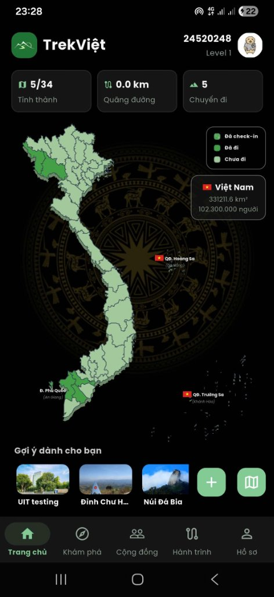
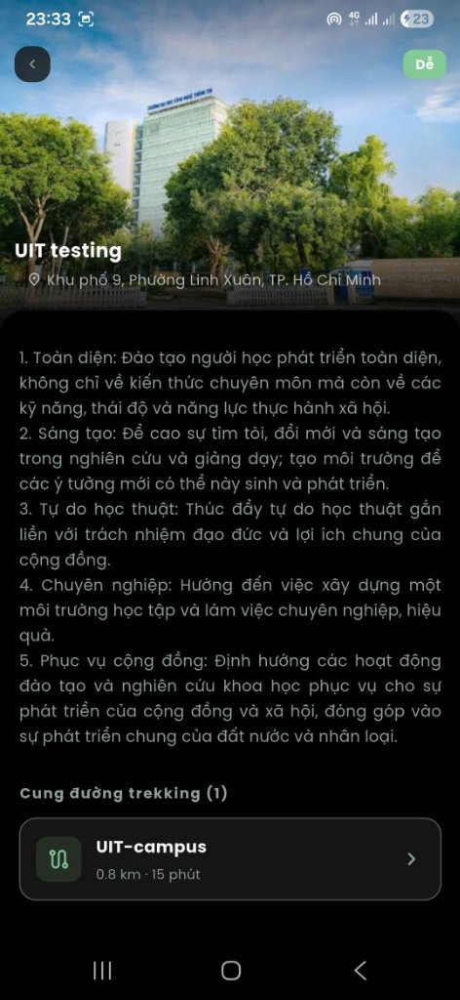
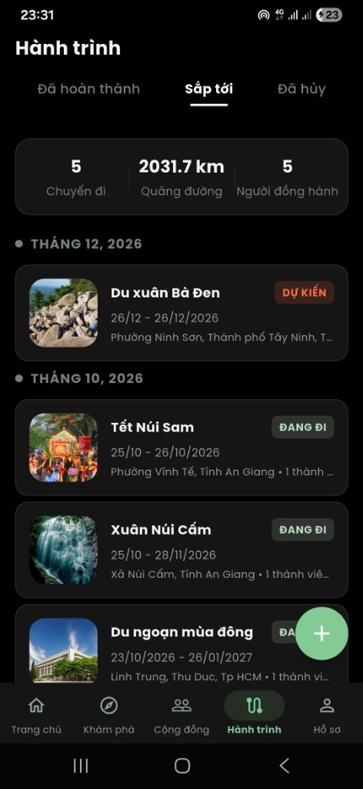
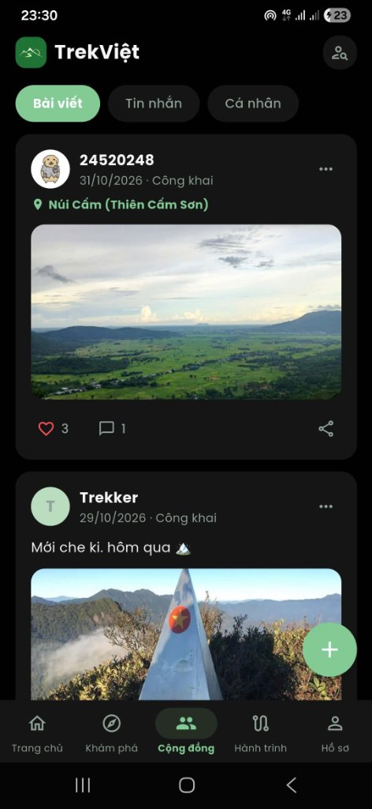
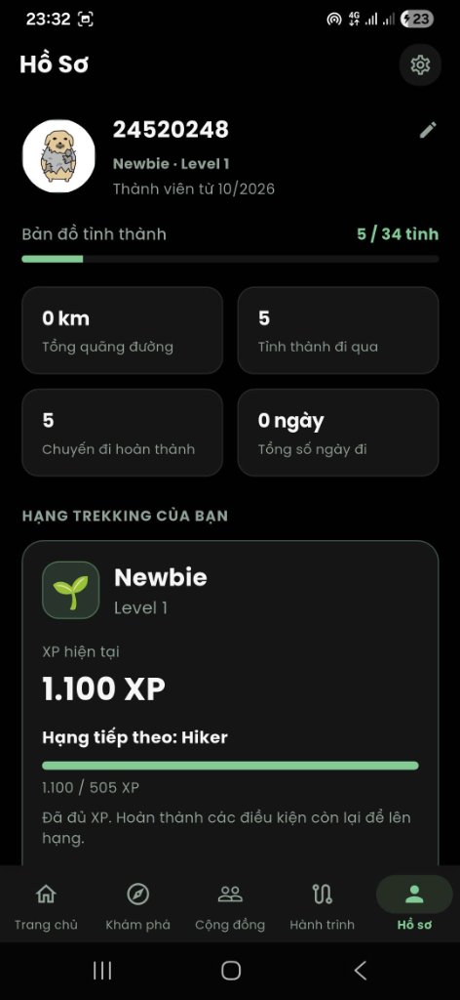
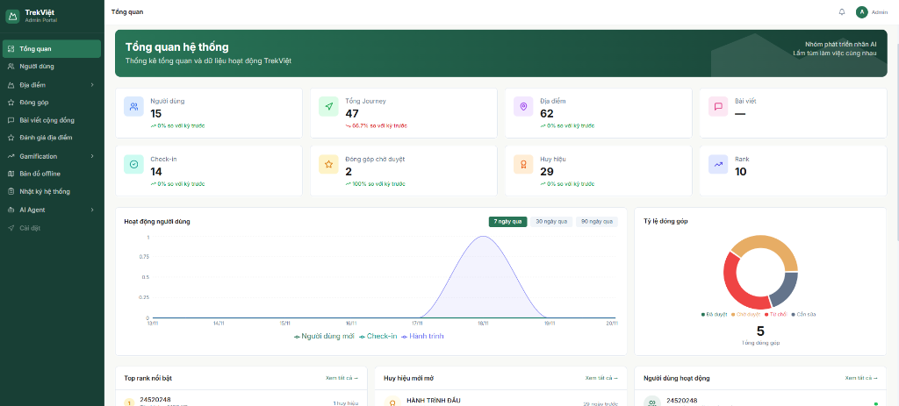

<p align="center">
  <br>
  
  <br><br>
</p>

<h1 align="center">TrekViệt - Ứng dụng hỗ trợ trekking tại Việt Nam</h1>

<p align="center">
  <strong>Đồ án môn học: Đồ án 1</strong>
</p>

<p align="center">
  &nbsp;
  &nbsp;
  &nbsp;
  &nbsp;
  &nbsp;
  &nbsp;
  &nbsp;
  
</p>

<details open>
  <summary><b>Mục lục</b></summary>
  <ol>
    <li><a href="#1-thành-viên-nhóm">Thành viên nhóm</a></li>
    <li><a href="#2-giới-thiệu-dự-án">Giới thiệu dự án</a></li>
    <li><a href="#3-tính-năng-nổi-bật">Tính năng nổi bật</a></li>
    <li><a href="#4-tech-stack">Tech Stack</a></li>
    <li><a href="#5-cấu-trúc-thư-mục">Cấu trúc thư mục</a></li>
    <li><a href="#6-hướng-dẫn-cài-đặt">Hướng dẫn cài đặt</a></li>
    <li><a href="#7-demo--ảnh-chụp-màn-hình">Demo / Ảnh chụp màn hình</a></li>
  </ol>
</details>

---

## 1. Thành viên nhóm

| STT | MSSV     | Họ và tên          | Vai trò              | GitHub                                                 |
|:---:|:--------:|:-------------------|:---------------------|:-------------------------------------------------------|
| 1   | 24520051 | Lê Văn An          | Backend & Web Admin  | [@LeVanAnUITK19](https://github.com/LeVanAnUITK19)     |
| 2   | 24520248 | Trần Thanh Dân     | Mobile App & Testing | [@danttse](https://github.com/danttse)                 |

---

## 2. Giới thiệu dự án

**TrekViệt** là ứng dụng di động hỗ trợ hoạt động đi bộ dã ngoại và leo núi (trekking) tại Việt Nam, tập trung giải quyết bài toán định vị và dẫn đường khi người dùng di chuyển vào các khu vực rừng núi hiểm trở **hoàn toàn mất kết nối sóng viễn thông và Internet**.

Hệ thống được phát triển theo kiến trúc **Offline-First**, kết hợp giữa:
- **Ứng dụng di động (Flutter):** Vận hành độc lập ngoài thực địa với cơ sở dữ liệu cục bộ SQLite, hiển thị bản đồ địa hình từ tệp MBTiles, ghi nhận tọa độ GPS thời gian thực và dẫn đường quay lại (Backtrack) chống lạc.
- **Hệ thống Máy chủ & Cổng quản trị (Node.js/Express & Web Admin):** Tiếp nhận dữ liệu đồng bộ khi thiết bị có mạng, hỗ trợ quản lý danh mục địa điểm, quản lý người dùng và kiểm duyệt các lộ trình trekking do cộng đồng đóng góp.

---

## 3. Tính năng nổi bật

### Dành cho Người dùng thực địa (Mobile App)
- **Bản đồ số ngoại tuyến:** Tải trước gói dữ liệu địa điểm (bao gồm tệp vector tiles `.mbtiles`, danh sách cột mốc, lộ trình). Bản đồ hiển thị mượt mà không phụ thuộc vào kết nối mạng.
- **Theo dõi hành trình (GPS Tracking):** Bắt tọa độ GPS định kỳ, lưu vệt di chuyển vào bộ nhớ máy và vẽ lộ trình trực quan trên nền bản đồ MapLibre.
- **Dẫn đường quay lại (Backtrack):** Tự động đảo ngược chuỗi tọa độ đã đi để hỗ trợ người dùng tìm đường quay về điểm xuất phát khi gặp thời tiết xấu hoặc mất phương hướng.
- **Thẩm định Check-in cột mốc:** Ứng dụng công thức tính khoảng cách không gian (Haversine) để xác thực check-in tại các đỉnh núi, trạm nghỉ khi đạt bán kính và độ chính xác GPS quy định.
- **Cộng đồng:** Đăng bài viết chia sẻ kinh nghiệm dã ngoại kèm hình ảnh, tương tác bình luận thời gian thực qua REST API và WebSocket.
- **Đóng góp cung đường:** Cho phép chia sẻ lại lộ trình GPS thực tế sau khi hoàn thành hành trình để ban quản trị kiểm duyệt.

### Dành cho Quản trị viên (Web Admin Portal)
- **Quản lý danh mục:** Thêm, sửa, vô hiệu hóa các địa điểm, cung đường trekking và danh sách cột mốc chuẩn.
- **Kiểm duyệt đóng góp:** Trực quan hóa vệt GPS do người dùng đóng góp trên giao diện bản đồ để đối chiếu, kiểm tra trùng lặp trước khi xuất bản thành cung đường chính thức.
- **Giám sát & Báo cáo:** Theo dõi số liệu người dùng, bài đăng cộng đồng và quản lý lịch sử kiểm toán (Audit Log).

---

## 4. Tech Stack

### Phân hệ Di động (Mobile App)
- **Ngôn ngữ & Framework:** Dart, Flutter SDK ($\ge$ 3.13.2).
- **Bản đồ & GIS:** `maplibre_gl`, `shelf` & `shelf_router` (chạy HTTP server cục bộ phục vụ MBTiles).
- **Lưu trữ cục bộ:** `sqflite` (SQLite), `flutter_secure_storage`, `shared_preferences`.
- **Cảm biến vị trí:** `geolocator`.
- **Giao tiếp mạng:** `dio`, WebSocket client.
- **Xử lý tệp & Mã hóa:** `archive` (giải nén ZIP package), `crypto` (xác thực SHA-256).

### Phân hệ Máy chủ & Web Admin (Backend & Admin Portal)
- **Nền tảng:** Node.js, Express.js (Kiến trúc Microservices).
- **Cơ sở dữ liệu:** MongoDB Atlas (Database per service).
- **Hàng đợi thông điệp:** RabbitMQ (Xử lý tác vụ đồng bộ bất đồng bộ).
- **Lưu trữ tệp & Bản đồ:** Cloudflare R2 / Cloudinary.
- **Web Admin Portal:** React.js / Vite Dashboard.
- **Đóng gói & Triển khai:** Docker, Docker Compose.

---

## 5. Cấu trúc thư mục

```bash
vietnam_trekking_mobile/
├── android/                 # Cấu hình dự án cho nền tảng Android
├── assets/                  # Tài nguyên tĩnh của ứng dụng
│   ├── fonts/               # Phông chữ hệ thống
│   ├── images/              # Hình ảnh tĩnh và logo
│   │   └── Logo-khoa-mem.png# Logo Khoa Công nghệ Phần mềm
│   └── offline_maps/        # Dữ liệu gói bản đồ mẫu (.zip, .geojson)
├── docs/                    # Tài liệu và hình ảnh giới thiệu
│   └── badges/              # Logo các công nghệ sử dụng (.svg)
├── lib/                     # Mã nguồn chính của ứng dụng di động
│   ├── app/                 # Khởi tạo ứng dụng, router, cấu hình theme
│   ├── core/                # Các thành phần dùng chung (network, database, utils)
│   │   ├── database/        # Cấu hình SQLite cục bộ và migrations
│   │   └── services/        # Dịch vụ định vị, secure storage, shelf local server
│   └── features/            # Kiến trúc module theo tính năng
│       ├── auth/            # Đăng nhập, đăng ký tài khoản
│       ├── explore/         # Khám phá địa điểm, danh sách cung đường
│       ├── offline_map/     # Tải và quản lý gói bản đồ ngoại tuyến
│       ├── journey/         # Ghi vết GPS, HUD theo dõi và Backtrack
│       ├── community/       # Bảng tin cộng đồng, đăng bài, bình luận
│       ├── profile/         # Hồ sơ cá nhân, cấp bậc (Rank/XP), huy hiệu
│       └── route/           # Đóng góp cung đường thực tế
└── test/                    # Bộ kiểm thử đơn vị và kiểm thử tích hợp
```

---

## 6. Hướng dẫn cài đặt

### Cách 1: Cài đặt trực tiếp bằng file APK (Trải nghiệm nhanh)

1. Tải tệp tin `app-release.apk` mới nhất tại mục [Releases](https://github.com/danttse/vietnam_trekking_mobile/releases).
2. Chuyển file vào điện thoại Android và tiến hành cài đặt (chấp nhận quyền cài đặt từ nguồn không xác định nếu có yêu cầu).
3. Mở ứng dụng **TrekViệt** và cấp quyền **Vị trí (Location)** để sử dụng các tính năng bản đồ và ghi nhận GPS ngoại tuyến.

### Cách 2: Khởi chạy từ mã nguồn (Dành cho nhà phát triển)

**Yêu cầu:** [Flutter SDK](https://docs.flutter.dev/get-started/install) ($\ge$ 3.13.2) và Android Studio / VS Code.

```bash
# 1. Sao chép mã nguồn
git clone https://github.com/danttse/vietnam_trekking_mobile.git
cd vietnam_trekking_mobile

# 2. Cài đặt các thư viện phụ thuộc
flutter pub get

# 3. Khởi chạy ứng dụng
# Chạy với cấu hình kết nối API Gateway cục bộ (10.0.2.2 cho máy ảo Android):
flutter run --dart-define=API_BASE_URL=http://10.0.2.2:3000/api/v1 \
            --dart-define=COMMUNITY_BASE_URL=http://10.0.2.2:3000/api/v1 \
            --dart-define=TREKKING_BASE_URL=http://10.0.2.2:3000/api/v1
```

---

## 7. Demo / Ảnh chụp màn hình

### Phân hệ Ứng dụng Di động (Mobile App)

<div align="center">
  
  &nbsp;&nbsp;
  
  &nbsp;&nbsp;
  
  &nbsp;&nbsp;
  
  &nbsp;&nbsp;
  
</div>

<br/>

### Phân hệ Quản trị (Web Admin Portal)

<div align="center">
  
</div>
