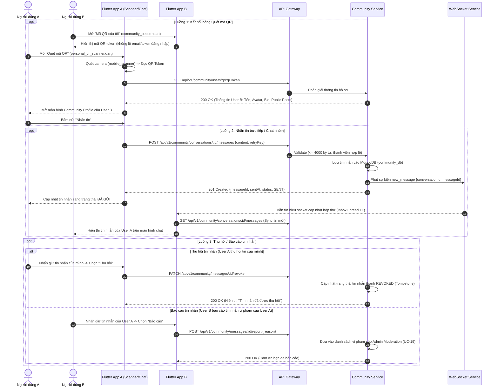
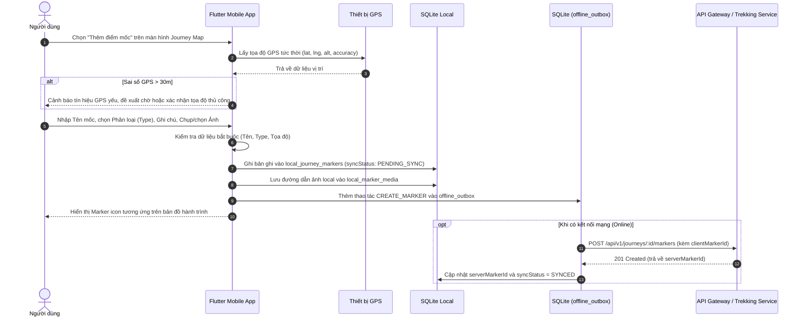

# KẾ HOẠCH NÂNG CẤP VÀ CHUẨN HÓA TÀI LIỆU ĐẶC TẢ YÊU CẦU PHẦN MỀM (SRS v3.1)
**Hệ thống:** Nền tảng hỗ trợ trekking TrekViệt  
**Phiên bản mục tiêu:** SRS v3.1 (Baseline cập nhật)  
**Cơ sở đối chuẩn:** Hiện trạng mã nguồn (`vietnam_trekking_mobile`, `Backend-TrekVN`) và tiêu chuẩn quốc tế **ISO/IEC/IEEE 29148:2018**  

---

## MỤC LỤC
1. [PHẦN 1: Kế hoạch Bổ sung & Đặc tả Chi tiết Tính năng (Theo Hiện trạng Hệ thống)](#phần-1-kế-hoạch-bổ-sung--đặc-tả-chi-tiết-tính-năng-theo-hiện-trạng-hệ-thống)
   - [1.1. Bổ sung UC: Nhắn tin trực tiếp, Chat nhóm và Kết nối QR (Community Social & Messaging)](#11-bổ-sung-uc-nhắn-tin-trực-tiếp-chat-nhóm-và-kết-nối-qr-community-social--messaging)
   - [1.2. Bổ sung UC: Tạo và Quản lý Điểm mốc cá nhân (Journey Markers)](#12-bổ-sung-uc-tạo-và-quản-lý-điểm-mốc-cá-nhân-journey-markers)
   - [1.3. Mở rộng UC: Hệ thống Cấp bậc (10 Ranks) và Lịch sử Điểm kinh nghiệm (XP)](#13-mở-rộng-uc-hệ-thống-cấp-bậc-10-ranks-và-lịch-sử-điểm-kinh-nghiệm-xp)
   - [1.4. Bổ sung UC: Quên / Đặt lại mật khẩu (Password Recovery qua OTP) & Đổi mật khẩu](#14-bổ-sung-uc-quên--đặt-lại-mật-khẩu-password-recovery-qua-otp--đổi-mật-khẩu)
   - [1.5. Chuẩn hóa Nghiệp vụ: Tự đánh dấu Tỉnh đã ghé thăm (SELF_REPORTED vs VERIFIED)](#15-chuẩn-hóa-nghiệp-vụ-tự-đánh-dấu-tỉnh-đã-ghé-thăm-self_reported-vs-verified)
   - [1.6. Chuẩn hóa Cơ chế Tải Gói Bản đồ Ngoại tuyến cấp Địa điểm (Place-level Offline Package)](#16-chuẩn-hóa-cơ-chế-tải-gói-bản-đồ-ngoại-tuyến-cấp-địa-điểm-place-level-offline-package)
2. [PHẦN 2: Kế hoạch Hoàn thiện & Chuẩn hóa Nội dung (Theo ISO/IEC/IEEE 29148)](#phần-2-kế-hoạch-hoàn-thiện--chuẩn-hóa-nội-dung-theo-isoiecieee-29148)
   - [2.1. Bổ sung Phân tích Nhóm người dùng & Môi trường Tác nghiệp thực tế](#21-bổ-sung-phân-tích-nhóm-người-dùng--môi-trường-tác-nghiệp-thực-tế)
   - [2.2. Đo lường hóa các Yêu cầu Phi chức năng (NFR Metrics)](#22-đo-lường-hóa-các-yêu-cầu-phi-chức-năng-nfr-metrics)
   - [2.3. Tách bạch Phân loại Yêu cầu (Chức năng vs Phi chức năng vs Ràng buộc)](#23-tách-bạch-phân-loại-yêu-cầu-chức-năng-vs-phi-chức-năng-vs-ràng-buộc)
3. [PHẦN 3: Kế hoạch Chuẩn hóa Hình thức & Trình bày](#phần-3-kế-hoạch-chuẩn-hóa-hình-thức--trình-bày)
   - [3.1. Tái cấu trúc Phụ lục C và Đồng bộ Lược đồ Dữ liệu](#31-tái-cấu-trúc-phụ-lục-c-và-đồng-bộ-lược-đồ-dữ-liệu)
   - [3.2. Chuẩn hóa Quy cách Thể hiện Sơ đồ Tuần tự (Sequence Diagram)](#32-chuẩn-hóa-quy-cách-thể-hiện-sơ-đồ-tuần-tự-sequence-diagram)
   - [3.3. Thống nhất Từ điển Thuật ngữ Song ngữ (Glossary)](#33-thống-nhất-từ-điển-thuật-ngữ-song-ngữ-glossary)
4. [PHẦN 4: Ma trận Cập nhật Truy vết & Danh mục Nghiệm thu (Traceability & Verification)](#phần-4-ma-trận-cập-nhật-truy-vết--danh-mục-nghiệm-thu-traceability--verification)
   - [4.1. Bảng mã hóa Danh mục Use Case đầy đủ cho SRS v3.1 (26 Use Cases)](#41-bảng-mã-hóa-danh-mục-use-case-đầy-đủ-cho-srs-v31-26-use-cases)
   - [4.2. Tiêu chí Nghiệm thu Bổ sung (Acceptance Criteria Updates)](#42-tiêu-chí-nghiệm-thu-bổ-sung-acceptance-criteria-updates)

---

## PHẦN 1: KẾ HOẠCH BỔ SUNG & ĐẶC TẢ CHI TIẾT TÍNH NĂNG (THEO HIỆN TRẠNG HỆ THỐNG)

### 1.1. Bổ sung UC: Nhắn tin trực tiếp, Chat nhóm và Kết nối QR (Community Social & Messaging)
*Hiện trạng mã nguồn: Đã hiện thực tại `lib/features/community` (`community_messages.dart`, `conversation_screen.dart`, `create_group_screen.dart`, `group_details_screen.dart`, `personal_qr_scanner.dart`, `community_profile_screen.dart`), tài liệu kiến trúc `docs/community-social.md` và backend routes `/api/v1/community/...`.*

#### Đặc tả chi tiết Use Case: UC-23 (Nhắn tin trực tiếp, Chat nhóm và Kết nối QR)
* **Tác nhân chính:** Người dùng (Người trekking có nhu cầu kết nối, trao đổi đoàn đội).
* **Tiền điều kiện:** Người dùng đã đăng nhập hệ thống (`ACTIVE`) và thiết bị có kết nối Internet.
* **Hậu điều kiện thành công:** Tin nhắn được gửi thành công, người nhận/nhóm nhận được thông báo/cập nhật dữ liệu tức thời; nhóm chat được tạo/quản lý đúng quyền.
* **Quy mô nghiệp vụ:**
  * Hỗ trợ Chat 1-1 (Direct Message) và Chat nhóm (Group Chat - tối đa 50 người/nhóm).
  * Độ dài tin nhắn: Tối đa 4,000 ký tự văn bản thuần (MVP chưa hỗ trợ gọi điện, voice hoặc push media trong chat).
  * Giao thức: Gửi tin qua REST API (`POST /community/conversations/:id/messages`), WebSocket chỉ đóng vai trò thông báo thay đổi tức thời (Invalidation / New message ping).
  * Kết nối nhanh: Mỗi tài khoản có một mã QR định danh (random token có thể cấp lại - Revoke & Regenerate) để quét kết bạn/nhắn tin ngay mà không lộ email cá nhân.



* **Luồng sự kiện chính (Main Flow):**
  1. **Tìm kiếm & Bắt đầu trò chuyện:**
     * Người dùng có thể tìm người khác bằng cách nhập chính xác Email, hoặc mở Camera quét mã QR cá nhân (`personal_qr_scanner.dart`).
     * Xem hồ sơ cộng đồng của người đó (`community_profile_screen.dart`), bấm "Nhắn tin" để mở cuộc hội thoại. Không bắt buộc phải kết bạn hai chiều mới được nhắn tin.
  2. **Quản lý Hộp thư (Inbox) & Chat:**
     * Màn hình Inbox hiển thị danh sách các cuộc hội thoại 1-1 và hội thoại nhóm, kèm số lượng tin nhắn chưa đọc (`unreadCount`).
     * Trong màn hình chat (`conversation_screen.dart`), người dùng nhập nội dung văn bản (tối đa 4000 ký tự) và bấm Gửi.
     * Tin nhắn gửi đi kèm mã định danh retry (`retryKey`). Nếu mất mạng tạm thời, tin nhắn giữ trạng thái lỗi cục bộ để người dùng bấm Thử lại (Retry), không làm mất nội dung đang soạn thảo.
  3. **Tạo và Quản trị Nhóm chat (Group Chat):**
     * Người dùng chọn "Tạo nhóm mới" (`create_group_screen.dart`), đặt tên nhóm, chọn ảnh đại diện nhóm và chọn danh sách thành viên tham gia (tối đa 50 người).
     * Trưởng nhóm có quyền: Đổi tên nhóm, thêm thành viên mới, gỡ thành viên ra khỏi nhóm, chuyển quyền trưởng nhóm cho người khác, hoặc giải tán nhóm (`group_details_screen.dart`).
     * Thành viên có quyền: Tự rời khỏi nhóm bất kỳ lúc nào.
* **Các quy tắc nghiệp vụ đặc thù (Business Rules):**
  * *Bảo vệ quyền riêng tư QR:* Mã QR cá nhân chỉ chứa token ngẫu nhiên, không chứa email, số điện thoại hay token xác thực đăng nhập. Người dùng có nút "Cấp lại mã QR" bất kỳ lúc nào để vô hiệu hóa mã QR cũ nếu bị chia sẻ công khai ngoài ý muốn.
  * *Bảo mật lịch sử chat nhóm:* Thành viên mới được thêm vào nhóm (hoặc người cũ được thêm lại) **chỉ đọc được tin nhắn từ thời điểm được thêm vào trở về sau**, không được phép đọc lại lịch sử tin nhắn trước đó.
  * *Thu hồi tin nhắn (Tombstone):* Chỉ người gửi mới có quyền thu hồi tin nhắn của mình. Khi thu hồi, nội dung tin nhắn được đổi thành *"Tin nhắn đã được thu hồi"* ở cả 2 phía.
  * *Báo cáo tin nhắn (Reporting):* Người dùng có thể nhấn giữ tin nhắn của người khác để báo cáo vi phạm (Spam, quấy rối, thông tin sai lệch). Bản ghi này sẽ được đẩy trực tiếp về trang Kiểm duyệt cộng đồng của Admin (UC-19).

---

### 1.2. Bổ sung UC: Tạo và Quản lý Điểm mốc cá nhân (Journey Markers)
*Hiện trạng mã nguồn: Đã hiện thực tại `MarkerModel`, `marker_form_screen.dart`, bảng SQLite `local_journey_markers`, các API `/api/v1/journeys/:id/markers` và luồng Admin review marker đóng góp.*

#### Đặc tả chi tiết Use Case: UC-24 (Tạo và Quản lý Điểm mốc cá nhân)
* **Tác nhân chính:** Người dùng (Người trekking đang trong hành trình `ACTIVE`).
* **Tiền điều kiện:** 
  1. Người dùng đang có một Journey ở trạng thái `ACTIVE`.
  2. Thiết bị đã bật GPS và cấp quyền vị trí cho ứng dụng.
* **Hậu điều kiện thành công:** Điểm mốc được lưu vào cơ sở dữ liệu SQLite local, hiển thị marker trên bản đồ MapLibre, đưa vào hàng đợi `offline_outbox` để đồng bộ khi có Internet.
* **Phân loại Marker (10 loại cố định):** `VIEWPOINT`, `REST_POINT`, `WATER_POINT`, `CAMP`, `DANGER`, `INTERSECTION`, `SUMMIT`, `LANDMARK`, `PHOTO_SPOT`, `OTHER`.



* **Mối liên kết với luồng Đóng góp cung đường (UC-13 & UC-21):**
  * Khi kết thúc hành trình và chọn "Đóng góp cung đường", toàn bộ các Marker cá nhân tạo trong hành trình sẽ được đính kèm vào payload `POST /api/v1/contributions/routes` (`markerIds`).
  * Admin khi duyệt đóng góp (UC-21) có quyền xem từng marker, chỉnh sửa thông tin, và quyết định phê duyệt marker đó thành **Milestone chính thức** của hệ thống (`POST /api/v1/admin/contributions/:id/markers/:markerId/review`).

---

### 1.3. Mở rộng UC: Hệ thống Cấp bậc (10 Ranks) và Lịch sử Điểm kinh nghiệm (XP)
*Hiện trạng mã nguồn: Đã hiện thực tại `rank_detail_screen.dart`, `xp_history_screen.dart`, `rank_promotion_dialog.dart`, bảng rank cấu hình tại `auth-service`, và sự kiện RabbitMQ.*

#### Tích hợp vào UC-10: Xem Thành tích, Cấp bậc (Rank) và Huy hiệu (Badge)
* **Bảng 10 Cấp bậc tiêu chuẩn (Rank Configuration):**

| Cấp | Mã Rank | Tên hiển thị | XP tối thiểu | Cung đường tối thiểu | Tỉnh tối thiểu | Huy hiệu tối thiểu | Quãng đường tối thiểu | Đóng góp duyệt |
|:---:|:---|:---|:---:|:---:|:---:|:---:|:---:|:---:|
| 1 | `NEWBIE` | Tân thủ | 0 | 0 | 0 | 0 | 0 km | 0 |
| 2 | `HIKER` | Người dạo bộ | 500 | 1 | 1 | 1 | 5 km | 0 |
| 3 | `EXPLORER` | Người khám phá | 1,500 | 3 | 2 | 2 | 20 km | 0 |
| 4 | `TREKKER` | Người leo núi | 3,500 | 5 | 3 | 4 | 50 km | 0 |
| 5 | `PATHFINDER` | Người dẫn đường | 7,000 | 8 | 5 | 6 | 100 km | 1 |
| 6 | `MOUNTAINEER`| Nhà leo núi | 12,000 | 12 | 8 | 8 | 200 km | 2 |
| 7 | `ADVENTURER` | Nhà thám hiểm | 20,000 | 18 | 12 | 12 | 350 km | 3 |
| 8 | `ELITE_TREKKER`| Kiện tướng Trekking| 35,000 | 25 | 18 | 16 | 600 km | 5 |
| 9 | `TREK_MASTER`| Bậc thầy Trekking | 55,000 | 35 | 25 | 20 | 1,000 km | 8 |
| 10 | `TREK_LEGEND`| Huyền thoại TrekViệt| 80,000 | 50 | 34 | 25 | 1,500 km | 12 |

* **Quy tắc cộng điểm kinh nghiệm (XP Allocation Rules):**
  * `JOURNEY_COMPLETED`: +100 XP (cộng thêm 10 XP cho mỗi km quãng đường hoàn thành).
  * `MILESTONE_CHECKIN`: +30 XP (chỉ áp dụng cho check-in GPS được backend xác minh hợp lệ `VERIFIED`).
  * `PROVINCE_FIRST_VISITED`: +200 XP (khi mở khóa một tỉnh mới lần đầu tiên).
  * `PLACE_FIRST_VISITED`: +150 XP (khi lần đầu hoàn thành hành trình tại một địa điểm mới).
  * `BADGE_EARNED`: +100 XP / +250 XP / +500 XP / +1000 XP (tương ứng độ hiếm COMMON / RARE / EPIC / LEGENDARY).
  * `ROUTE_APPROVED`: +500 XP (khi đóng góp cung đường được Admin phê duyệt công bố).
  * `PLACE_APPROVED`: +300 XP (khi đề xuất địa điểm mới được phê duyệt).

---

### 1.4. Bổ sung UC: Quên / Đặt lại mật khẩu (Password Recovery qua OTP) & Đổi mật khẩu
*Hiện trạng mã nguồn: Đã hiện thực tại `forgot_password_screen.dart`, `change_password_screen.dart`, các endpoints `auth-service`: `/api/v1/auth/forgot-password`, `/verify-reset-otp`, `/reset-password`, `/api/v1/users/me/password`.*

#### Đặc tả chi tiết Use Case: UC-25 (Khôi phục và Đổi mật khẩu)
* **Tác nhân:** Người dùng (chưa đăng nhập cần khôi phục mật khẩu, hoặc đã đăng nhập muốn đổi mật khẩu).
* **Tiền điều kiện:** Thiết bị có kết nối Internet (Online).
* **Hậu điều kiện:** Mật khẩu tài khoản được cập nhật mã hash mới (Bcrypt) trên server; các refresh token cũ bị thu hồi để đảm bảo an toàn.

```mermaid
sequenceDiagram
    autonumber
    actor User as Người dùng
    participant App as Flutter Mobile App
    participant Auth as Auth Service
    participant Email as Dịch vụ Email (SMTP/SES)
    participant DB as MongoDB (auth_db)

    User->>App: Chọn "Quên mật khẩu?" tại màn Login
    App-->>User: Hiển thị form nhập Email
    User->>App: Nhập Email đăng ký và bấm "Gửi mã xác thực"
    App->>Auth: POST /api/v1/auth/forgot-password {email}
    Auth->>DB: Kiểm tra Email tồn tại và tài khoản ACTIVE
    Auth->>DB: Sinh OTP 6 số (hết hạn sau 10 phút), lưu otp_verifications
    Auth->>Email: Gửi mã OTP về email của người dùng
    Auth-->>App: 200 OK (Mã xác thực đã được gửi)
    App-->>User: Chuyển sang màn hình nhập OTP và Mật khẩu mới
    User->>App: Nhập 6 số OTP + Mật khẩu mới + Xác nhận mật khẩu
    App->>App: Kiểm tra độ mạnh mật khẩu (>= 8 ký tự, chữ hoa, số)
    App->>Auth: POST /api/v1/auth/reset-password {email, otp, newPassword}
    Auth->>DB: Xác thực OTP hợp lệ và chưa hết hạn
    Auth->>DB: Băm mật khẩu (Bcrypt salt=10), cập nhật passwordHash
    Auth->>DB: Hủy bỏ mã OTP vừa dùng; thu hồi toàn bộ refresh_tokens hiện có
    Auth-->>App: 200 OK (Đặt lại mật khẩu thành công)
    App-->>User: Thông báo thành công, chuyển hướng người dùng về màn Đăng nhập
```

* **Quy tắc an toàn (Security Rules):**
  * Mã OTP gồm 6 chữ số ngẫu nhiên, có thời hạn hiệu lực tối đa 10 phút.
  * Giới hạn tần suất (Rate Limit): Tối đa 3 lần yêu cầu gửi lại OTP trong vòng 15 phút cho cùng một địa chỉ email.
  * Nhập sai OTP quá 5 lần liên tiếp sẽ tự động vô hiệu hóa mã OTP đó.
  * Với người dùng đăng nhập bằng Google OAuth (không có mật khẩu), hệ thống chặn luồng quên mật khẩu và trả về thông báo: *"Tài khoản liên kết Google. Vui lòng đăng nhập qua Google."*

---

### 1.5. Chuẩn hóa Nghiệp vụ: Tự đánh dấu Tỉnh đã ghé thăm (SELF_REPORTED vs VERIFIED)
*Hiện trạng mã nguồn: Model `visited_provinces`, API `PATCH /api/v1/visits/provinces/me/:provinceId`, tài liệu `offline-storage.md`.*

* **Ba trạng thái của một tỉnh đối với mỗi người dùng:**
  1. `UNVISITED` (Mặc định): Chưa từng đến.
  2. `SELF_REPORTED`: Người dùng tự tích chọn bằng tay trên giao diện bản đồ hành chính để lưu lại kỷ niệm các tỉnh mình từng đi trước đây.
  3. `VERIFIED`: Đã được hệ thống xác thực độc lập thông qua **GPS Milestone Check-in thành công** thuộc một hành trình hợp lệ.
* **Quy tắc chuyển dịch trạng thái bất biến (Immutable State Rules):**
  * Người dùng có quyền chuyển đổi qua lại giữa `UNVISITED` $\leftrightarrow$ `SELF_REPORTED` thủ công trên giao diện.
  * Khi một check-in GPS được `checkin-service` xác thực thành công tại một tỉnh, trạng thái của tỉnh đó **tự động thăng cấp** từ `UNVISITED` hoặc `SELF_REPORTED` lên `VERIFIED`.
  * **Quy tắc một chiều (No-downgrade Rule):** Một khi tỉnh đã đạt trạng thái `VERIFIED`, người dùng **không thể** tự ý hủy bỏ hoặc hạ cấp trạng thái của tỉnh đó về `SELF_REPORTED` hay `UNVISITED`. Dữ liệu xác thực GPS có giá trị cao nhất trong hồ sơ thành tích.

---

### 1.6. Chuẩn hóa Cơ chế Tải Gói Bản đồ Ngoại tuyến cấp Địa điểm (Place-level Offline Package)
*Hiện trạng mã nguồn: Sửa đổi tại `trekking-service` (`GET /places/:id/offline-package`), tài liệu `offline-storage.md` và `frontend-readiness-audit.md`.*

* Gói bản đồ ngoại tuyến vector (MBTiles) được quản lý theo **cấp Địa điểm (`Place`)** thay vì cấp Tuyến đường (`Route`).
* Một gói ngoại tuyến bao gồm:
  1. Thông tin chi tiết Địa điểm (`TrekkingPlace`) và danh sách toàn bộ các Tuyến đường (`TrekkingRoutes`) cùng Cột mốc (`Milestones`) trực thuộc.
  2. File lưu trữ vector tiles dạng nén ZIP (chứa file `.mbtiles`, file `style.json` và fonts/glyphs).
* Quy trình cài đặt phía Mobile: Tải file `.zip.part` vào thư mục tạm $\rightarrow$ Kiểm tra mã băm SHA-256 đối chiếu với checksum server $\rightarrow$ Giải nén an toàn $\rightarrow$ Mở kiểm tra tính toàn vẹn SQLite MBTiles $\rightarrow$ Cập nhật bản ghi `downloaded_maps` sang trạng thái `READY`.

---

## PHẦN 2: KẾ HOẠCH HOÀN THIỆN & CHUẨN HÓA NỘI DUNG (THEO ISO/IEC/IEEE 29148)

### 2.1. Bổ sung Phân tích Nhóm người dùng & Môi trường Tác nghiệp thực tế
Thay thế bảng mô tả 4 dòng sơ sài ở Mục 2.3 bằng bảng đặc tả người dùng theo tiêu chuẩn IEEE 29148:

| Nhóm người dùng | Trình độ công nghệ | Môi trường tác nghiệp thực tế | Nhu cầu và Ràng buộc đặc thù |
| :--- | :--- | :--- | :--- |
| **Người trekking dã ngoại (End User)** | Cơ bản đến Trung bình | • Ngoài trời, ánh nắng gắt, địa hình gồ ghề.<br>• Mất sóng di động hoàn toàn.<br>• Tay dính mồ hôi, dính nước mưa, hoặc đeo găng tay bảo hộ.<br>• Pin thiết bị có hạn, không có nguồn điện sạc ngoài sạc dự phòng. | • Cần nút bấm to, thao tác tối giản (1-2 chạm).<br>• Giao diện độ tương phản cao để đọc dưới nắng.<br>• Chế độ tiết kiệm pin tối đa cho tác vụ GPS.<br>• Hoạt động độc lập 100% khi mất mạng. |
| **Người đóng góp nội dung (Contributor)** | Trung bình | • Thường thao tác sau khi đã kết thúc chuyến đi, về tới nơi có mạng Wi-Fi hoặc 4G ổn định. | • Cần công cụ xem lại vệt GPS đã đi trước khi gửi.<br>• Cần xem trạng thái bài đóng góp (Đang duyệt / Cần sửa / Đã duyệt) và lý do từ chối. |
| **Quản trị viên hệ thống (Admin)** | Thành thạo máy tính | • Làm việc trên máy tính để bàn/laptop văn phòng, màn hình lớn, kết nối Internet tốc độ cao và ổn định. | • Cần công cụ trực quan hóa vệt bản đồ GeoJSON để đối chiếu đường thực tế.<br>• Cơ chế khóa lạc quan (Optimistic Locking) tránh 2 admin duyệt trùng 1 đóng góp. |

---

### 2.2. Đo lường hóa các Yêu cầu Phi chức năng (NFR Metrics)
Chuyển đổi toàn bộ các câu định tính chung chung trong Mục 7 thành các chỉ số kỹ thuật có thể đo lường và kiểm thử được (Measurable & Testable):

| Mã NFR | Danh mục | Yêu cầu định lượng chuẩn hóa (Target Metric) | Phương pháp kiểm thử |
| :--- | :--- | :--- | :--- |
| **NFR-BAT-01** | **Tiêu hao năng lượng (Battery Life)** | Tiến trình ghi GPS nền liên tục (Foreground Service + Local SQLite Persistence) **không được tiêu thụ vượt quá 4.5% dung lượng pin mỗi giờ** trên thiết bị tiêu chuẩn dung lượng pin 4500 mAh. | Đo kiểm bằng Android Battery Historian trong hành trình đi bộ thực địa 4 tiếng. |
| **NFR-STO-01** | **Bộ nhớ lưu trữ (Storage Footprint)** | Kích thước gói bản đồ ngoại tuyến cho một địa điểm tiêu chuẩn (zoom 10–15) **không được vượt quá 150 MB**. Tổng dung lượng bộ nhớ đệm SQLite không vượt quá 50 MB sau 100 hành trình. | Kiểm tra kích thước file ZIP trên Cloudflare R2 và kích thước file `.db` trên thiết bị. |
| **NFR-GPS-01** | **Lọc nhiễu định vị (GPS Accuracy)** | Hệ thống tự động loại bỏ các điểm GPS có bán kính sai số $accuracy > 25m$, hoặc vận tốc di chuyển bất thường $> 15 km/h$ (bước nhảy tọa độ ảo khi mất bám vệ tinh trong rừng). | Chạy bộ kiểm thử mô phỏng tọa độ GPS lỗi và kiểm tra bảng `track_points`. |
| **NFR-PERF-01**| **Thời gian đáp ứng (Response Time)** | Thời gian phản hồi của các API đọc dữ liệu qua API Gateway đạt $p95 \le 1.5$ giây và $p99 \le 3.0$ giây dưới mức tải mục tiêu 200 CCU. | Chạy kịch bản kiểm thử tải bằng k6 / JMeter. |
| **NFR-REL-01** | **Độ tin cậy dữ liệu (Data Loss Prevention)** | Tỷ lệ mất mát điểm GPS và bản ghi check-in khi ứng dụng bị tắt đột ngột (OS low memory kill / sập nguồn) là **0%** (do ghi trực tiếp xuống SQLite theo từng điểm/sự kiện). | Kiểm thử cưỡng chế dừng tiến trình (`kill -9`) và kiểm tra khôi phục khi mở lại app. |

---

### 2.3. Tách bạch Phân loại Yêu cầu (Chức năng vs Phi chức năng vs Ràng buộc)
* **Chuyển `NFR-USE-01`** (*"UI phân biệt online/offline, downloaded, pending/synced..."*) $\rightarrow$ Chuyển sang nhóm **Yêu cầu chức năng giao diện (`FR-UI-01`)**.
* **Chuyển `NFR-DATA-01`** (*"Unique check-in/badge/idempotency..."*) $\rightarrow$ Chuyển sang nhóm **Quy tắc toàn vẹn dữ liệu (Data Integrity / Business Rules `BR-23`)**.
* Giữ nguyên nhóm NFR chuẩn mực gồm 6 trụ cột: **Performance, Energy Efficiency (Pin), Reliability & Offline, Security & Privacy, Maintainability, Usability**.

---

## PHẦN 3: KẾ HOẠCH CHUẨN HÓA HÌNH THỨC & TRÌNH BÀY

### 3.1. Tái cấu trúc Phụ lục C và Đồng bộ Lược đồ Dữ liệu
1. Xóa bỏ hoàn toàn giọng văn ghi chú nhật ký sửa lỗi trong Phụ lục C.
2. Tích hợp trực tiếp các bảng cơ sở dữ liệu mới (`route_submissions`, `place_suggestions`, `audit_logs`, `local_journey_markers`, `local_contributions`, `conversations`, `messages`) vào **Mục 9 (Yêu cầu Dữ liệu và Đồng bộ)**.
3. Đổi tên Phụ lục C thành: **Phụ lục C: Bảng tham chiếu ánh xạ Lược đồ Cơ sở dữ liệu (Database Schema Mapping)**, chỉ chứa cấu trúc bảng, kiểu dữ liệu, ràng buộc khóa và mục đích sử dụng.

### 3.2. Chuẩn hóa Quy cách Thể hiện Sơ đồ Tuần tự (Sequence Diagram)
1. Phân rã sơ đồ: Mỗi Use Case chỉ đính kèm **duy nhất một sơ đồ tuần tự độc lập** tương ứng với ca sử dụng đó.
2. Đánh số bước tuần tự (`autonumber`) rõ ràng, tên thông điệp trên đường truyền phải ghi kèm phương thức và endpoint HTTP (ví dụ: `POST /api/v1/auth/login`).
3. Chỉ giữ sơ đồ tuần tự cho các ca sử dụng phức tạp: **UC-01, UC-04, UC-05, UC-06, UC-07, UC-08, UC-13, UC-21, UC-23 (Chat & QR), UC-24 (Custom Markers), UC-25 (Reset Password)**.

### 3.3. Thống nhất Từ điển Thuật ngữ Song ngữ (Glossary)
Thống nhất việc sử dụng thuật ngữ xuyên suốt tài liệu:

| Thuật ngữ tiếng Anh | Thuật ngữ tiếng Việt quy ước | Định nghĩa chuẩn xác trong ngữ cảnh hệ thống |
| :--- | :--- | :--- |
| **Milestone** | Cột mốc chuẩn | Điểm mốc chính thức trên tuyến đường do Quản trị viên thiết lập sẵn (START, SUMMIT, CAMP...). |
| **Marker (Custom Marker)**| Điểm mốc cá nhân | Điểm do người dùng tự ghim trên bản đồ trong lúc trekking (điểm ngắm cảnh, nguồn nước, nguy hiểm...). |
| **Offline Outbox / Sync Queue** | Hàng đợi ngoại tuyến | Bảng lưu trữ cục bộ trên SQLite chứa các tác vụ đang chờ gửi lên server khi có mạng. |
| **Direct Message / Group Chat**| Nhắn tin trực tiếp / Chat nhóm | Tính năng trò chuyện 1-1 hoặc trò chuyện nhóm (tối đa 50 người) thời gian thực trong cộng đồng. |
| **Personal QR Token** | Mã QR định danh cá nhân | Token ngẫu nhiên có thể cấp lại đại diện cho hồ sơ người dùng để quét kết nối nhanh. |
| **Route Submission** | Đóng góp cung đường | Hồ sơ gửi vệt GPS và thông số chuyến đi hoàn thành từ người dùng để Admin duyệt thành Route chuẩn. |
| **Place Suggestion** | Đề xuất địa điểm | Hồ sơ gợi ý một địa điểm leo núi mới kèm tọa độ và mô tả gửi lên Admin. |
| **Backtrack** | Quay lại theo vệt GPS | Tính năng đảo ngược chuỗi tọa độ đã đi để dẫn đường người dùng quay về vị trí xuất phát an toàn. |

---

## PHẦN 4: MA TRẬN CẬP NHẬT TRUY VẾT & DANH MỤC NGHIỆM THU (TRACEABILITY & VERIFICATION)

### 4.1. Bảng mã hóa Danh mục Use Case đầy đủ cho SRS v3.1 (26 Use Cases)

| Mã UC | Tên Use Case | Phân hệ / Tác nhân | Nguồn gốc / Trạng thái |
| :--- | :--- | :--- | :--- |
| **UC-01** | Đăng ký và Đăng nhập | Mobile / Người dùng | Kế thừa v3.0 |
| **UC-02** | Quản lý Hồ sơ và Cài đặt | Mobile / Người dùng | Kế thừa v3.0 |
| **UC-03** | Khám phá Địa điểm và Cung đường | Mobile / Người dùng | Kế thừa v3.0 |
| **UC-04** | Tải Gói Bản đồ Ngoại tuyến Địa điểm | Mobile / Người dùng | Chuẩn hóa theo Place-level |
| **UC-05** | Tạo và Quản lý Hành trình (Journey) | Mobile / Người dùng | Kế thừa v3.0 |
| **UC-06** | Ghi GPS và Dẫn đường Quay lại (Backtrack) | Mobile / GPS / User | Bổ sung Adaptive GPS Sampling |
| **UC-07** | Check-in Cột mốc chuẩn (Milestones) | Mobile / GPS / User | Kế thừa v3.0 |
| **UC-08** | Đồng bộ Dữ liệu Ngoại tuyến (Outbox Sync) | Mobile / Worker / User| Kế thừa v3.0 |
| **UC-09** | Bản đồ Tỉnh và Thống kê Khám phá | Mobile / Người dùng | Bổ sung trạng thái SELF_REPORTED |
| **UC-10** | Cấp bậc (Rank), Huy hiệu (Badge) & XP | Mobile / Người dùng | **Mở rộng toàn diện hệ thống Rank/XP** |
| **UC-11** | Tương tác Bảng tin Cộng đồng (Feed/Post/Comment)| Mobile / Người dùng | Kế thừa v3.0 |
| **UC-12** | Đánh giá Địa điểm (Place Reviews) | Mobile / Người dùng | Kế thừa v3.0 |
| **UC-13** | Đóng góp Cung đường sau Hành trình | Mobile / Người dùng | Bổ sung gửi kèm Custom Markers |
| **UC-14** | Đề xuất Địa điểm Mới | Mobile / Người dùng | Kế thừa v3.0 |
| **UC-15** | Đăng nhập Quản trị (Admin Auth) | Web Admin / Admin | Kế thừa v3.0 |
| **UC-16** | Xem Bảng điều khiển Tổng quan (Dashboard)| Web Admin / Admin | Kế thừa v3.0 |
| **UC-17** | Quản lý Tài khoản Người dùng | Web Admin / Admin | Kế thừa v3.0 |
| **UC-18** | Quản lý Dữ liệu Trekking (Place/Route/Milestone) | Web Admin / Admin | Kế thừa v3.0 |
| **UC-19** | Kiểm duyệt Nội dung Cộng đồng | Web Admin / Admin | Bổ sung kiểm duyệt tin nhắn bị báo cáo |
| **UC-20** | Quản lý Huy hiệu & Phiên bản Bản đồ | Web Admin / Admin | Kế thừa v3.0 |
| **UC-21** | Duyệt Đóng góp (Route & Place Contributions) | Web Admin / Admin | Bổ sung duyệt Marker cá nhân |
| **UC-22** | Tra cứu Nhật ký Kiểm toán (Audit Logs) | Web Admin / Admin | Kế thừa v3.0 |
| **UC-23** | **Nhắn tin trực tiếp, Chat nhóm và Kết nối QR** | **Mobile / Người dùng** | **Bổ sung mới (Theo feature community thực tế)** |
| **UC-24** | **Tạo và Quản lý Điểm mốc cá nhân (Markers)** | **Mobile / Người dùng** | **Bổ sung mới (Theo feature journey thực tế)** |
| **UC-25** | **Khôi phục và Đặt lại Mật khẩu (Reset Password)**| **Mobile / Người dùng** | **Bổ sung mới (Theo feature auth thực tế)** |
| **UC-26** | **Quản lý Cấu hình Cấp bậc (Admin Rank Config)**| **Web Admin / Admin** | **Bổ sung mới (Theo api-route-inventory thực tế)**|

---

### 4.2. Tiêu chí Nghiệm thu Bổ sung (Acceptance Criteria Updates)
* **AC-25 (Community Messaging & QR):** 
  * Quét mã QR cá nhân phân giải chính xác hồ sơ người dùng mà không để lộ email;
  * Người dùng gửi và nhận được tin nhắn văn bản trong cuộc trò chuyện 1-1 và cuộc trò chuyện nhóm (tối đa 50 người);
  * Người gửi có thể thu hồi tin nhắn thành công; người nhận có thể báo cáo tin nhắn vi phạm gửi về hàng đợi Admin.
* **AC-26 (Custom Marker Creation):** 
  * Người dùng đang trong hành trình ACTIVE có thể tạo mốc cá nhân thuộc 1 trong 10 phân loại khi offline;
  * Marker hiển thị tức thì trên MapLibre; khi online đồng bộ thành công và nhận `serverMarkerId`.
* **AC-27 (Gamification Pipeline):** 
  * Sau khi hoàn thành hành trình hoặc check-in thành công, điểm XP được cộng chính xác theo quy tắc;
  * Nếu thỏa mãn đủ 6 tiêu chí của rank kế tiếp, trạng thái rank được cập nhật và hiển thị dialog chúc mừng thăng hạng.
* **AC-28 (Password Reset Flow):** 
  * Nhập email đăng ký nhận được mã OTP 6 số;
  * Nhập đúng OTP cho phép đổi mật khẩu mới; mật khẩu cũ không còn đăng nhập được; toàn bộ refresh token cũ bị vô hiệu hóa.
* **AC-29 (Place-level Map Package):** 
  * Tải gói offline của một địa điểm sẽ giải nén đúng bộ dữ liệu MBTiles dùng chung cho tất cả các tuyến đường thuộc địa điểm đó;
  * Installer từ chối các file ZIP có SHA-256 không trùng khớp với metadata.
* **AC-30 (Self-reported Province Marking):** 
  * Người dùng có thể tích chọn tỉnh bằng tay (SELF_REPORTED);
  * Khi có check-in GPS hợp lệ tại tỉnh đó, hệ thống tự động đổi sang VERIFIED; thao tác bỏ chọn bằng tay không thể hủy bỏ trạng thái VERIFIED.
